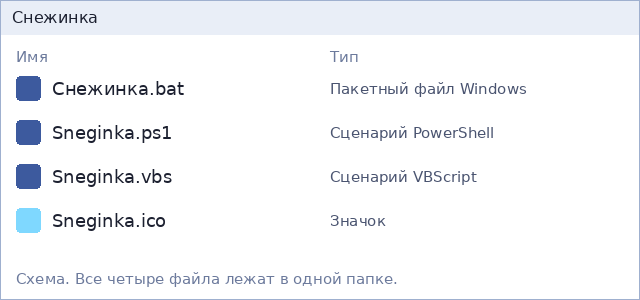
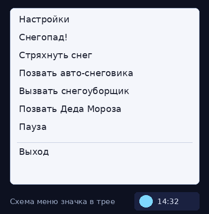

# Снежинка 2.0

Снег поверх рабочего стола Windows. Сугробы лежат на панели задач и на верхних краях окон. Снеговик собирается сам или по твоей команде. Снегоуборщик выезжает по расписанию. В меню значка в трее есть вызов Деда Мороза.

Установка не нужна. Утилита работает на PowerShell, который уже есть в Windows.

## Что нужно

1. Windows 10 или Windows 11.
2. PowerShell 5.1. Он встроен в систему, ставить ничего не нужно.
3. Папка, в которую ты можешь записывать файлы. Подойдут «Документы» или «Рабочий стол». Папки `Program Files` и `Windows` не подходят.

Чужие программы, интернет и права администратора не нужны. В коде нет сетевых запросов.

## Что лежит в комплекте

| Файл | Зачем нужен |
| --- | --- |
| `Sneginka.ps1` | Сама утилита. Здесь весь код. |
| `Снежинка.bat` | Запуск двойным щелчком. Перед стартом сохраняет `Sneginka.ps1` в кодировке UTF-8 с BOM, чтобы русский текст читался правильно. |
| `Sneginka.vbs` | Тот же запуск без мелькания окна. |
| `Sneginka.ico` | Значок для ярлыка. |

Все четыре файла держи в одной папке. Не разделяй их.

## Запуск за 5 шагов

1. Создай папку, например `Документы\Снежинка`.
2. Скопируй в нее все четыре файла.
3. Дважды щелкни по `Sneginka.vbs`. Если хочешь, запусти `Снежинка.bat`, результат тот же.
4. Подожди 2 или 3 секунды. В правом нижнем углу появится уведомление «Снежинка 2.0». Затем откроется окно настроек.
5. Найди значок снежинки в трее. Он находится слева от часов. Если значка не видно, нажми стрелку `^` рядом с часами.

Снег сначала идет слабо, потому что интенсивность по умолчанию 0%. Подними ползунок «Интенсивность» в окне настроек до 50% или выше.

## Меню значка в трее

Нажми правой кнопкой мыши на значок снежинки.

| Пункт | Что делает |
| --- | --- |
| Настройки | Открывает окно настроек. Двойной щелчок по значку делает то же самое. |
| Снегопад! | Включает сильный снегопад на несколько секунд. |
| Стряхнуть снег | Сбрасывает сугробы с панели задач и окон. |
| Позвать авто-снеговика | Снеговик собирается сам. |
| Вызвать снегоуборщик | Трактор выезжает и сгребает снег. |
| Позвать Деда Мороза | Дед выходит на панель задач. Сам он появляется редко, примерно раз в 20 минут и реже. |
| Пауза | Останавливает анимацию. |
| Выход | Закрывает утилиту полностью. |

## Как настроить под себя

Открой окно настроек и двигай ползунки.

1. Интенсивность задает, сколько снега идет.
2. Ветер двигает снежинки влево или вправо.
3. Размер снежинок. Чтобы разглядеть узоры лучей, поставь 100% или больше.
4. Качество. Для детальных снежинок выбери «высокое». На слабом ПК выбери «экономное».
5. Гирлянда переключается кнопкой. Есть 4 режима: выключена, разноцветная, теплая, ледяная.
6. Кнопка «Случайно» подбирает настройки сама. Кнопка «Сброс» возвращает исходные.
7. Кнопка «Снимок PNG» сохраняет скриншот экрана со снегом на рабочий стол.

## Ручной режим снеговика

1. В настройках нажми кнопку «Снеговик: авто» и убедись, что на ней написано «вручную».
2. Зажми левую кнопку мыши на сугробе у панели задач.
3. Веди мышь вправо или влево. Ком растет.
4. Отпусти кнопку. Ком остается лежать.
5. Сделай три кома разного размера и перетащи один на другой. Из трех комьев собирается снеговик.
6. Готового снеговика перетаскивай мышью. Клик по нему заставляет его махнуть рукой.

Трактор сносит комья и снеговиков. Отключи пункт «Трактор сносит комья и снеговиков», если не хочешь этого.

## Запуск вместе с Windows

1. Открой окно настроек.
2. Поставь галочку «Запускать вместе с Windows».
3. Перезагрузи ПК и проверь, что значок снежинки появился в трее.

Галочка записывает полный путь к `Sneginka.ps1` в реестр текущего пользователя. Если ты переместишь папку, сними галочку и поставь ее снова.

## Ярлык со значком на рабочем столе

1. Щелкни правой кнопкой по `Sneginka.vbs`.
2. Выбери «Отправить», затем «Рабочий стол (создать ярлык)».
3. Щелкни правой кнопкой по новому ярлыку и выбери «Свойства».
4. Нажми «Сменить значок», затем «Обзор».
5. Выбери `Sneginka.ico` из папки утилиты и нажми «ОК» два раза.

## Если что-то не работает

Ничего не запустилось, окна и значка нет. Windows блокирует файлы, скачанные из интернета.
1. Щелкни правой кнопкой по `Sneginka.ps1` и выбери «Свойства».
2. Внизу вкладки «Общие» поставь галочку «Разблокировать».
3. Нажми «ОК» и запусти утилиту снова.
То же сделай для `Sneginka.vbs` и `Снежинка.bat`.

Появилось окно «Снежинка не смогла запуститься». Открой файл ошибки. Нажми `Win + R`, введи `%TEMP%\Sneginka-error.log` и нажми Enter. Пришли текст из файла тому, кто тебе помогает.

Утилита уже запущена, а второй запуск ничего не делает. Это ожидаемо. Одновременно работает только одна копия. Закрой первую через пункт «Выход» в трее.

Антивирус показывает предупреждение. Утилита ставит перехват мыши. Он нужен, чтобы ты мог таскать комья и снеговика. Некоторые антивирусы реагируют на такие перехваты. Код открыт, его видно в `Sneginka.ps1`. Добавь папку в исключения антивируса.

Снег лагает. Открой настройки, выбери качество «экономное» и уменьши интенсивность.

Окна и значка нет, но процесс работает. Открой диспетчер задач. Найди «Windows PowerShell» и закрой его. Затем запусти утилиту заново.

## Как удалить

1. Щелкни правой кнопкой по значку в трее и выбери «Выход».
2. Если включал автозапуск, сначала сними галочку «Запускать вместе с Windows» в настройках.
3. Удали папку с четырьмя файлами.

Утилита ничего больше не устанавливает. Звуки она записывает во временную папку `%TEMP%\Sneginka` и удаляет при выходе.
